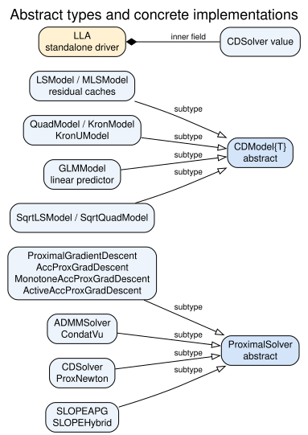
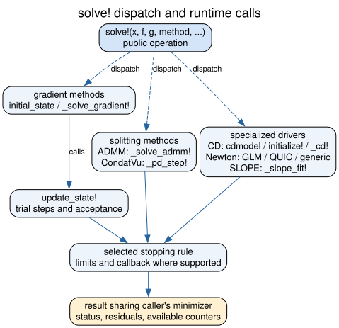
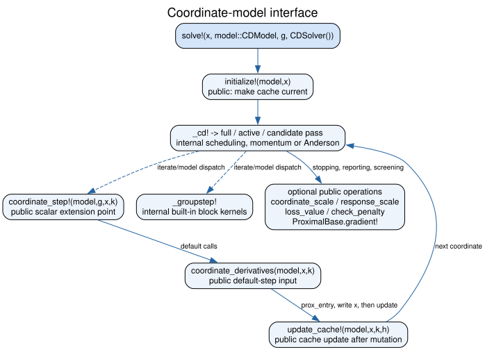
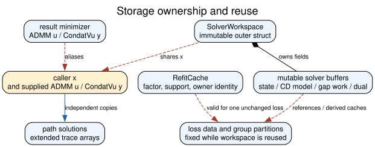
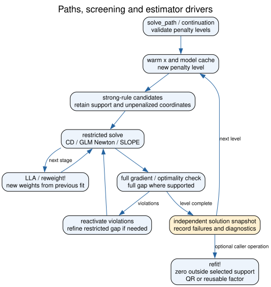
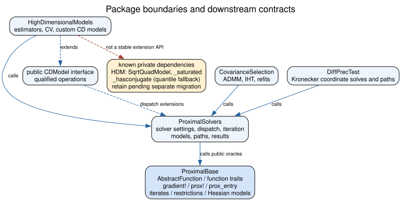

# Architecture

ProximalSolvers composes solver settings, model caches and iterate storage through
Julia fields and specializes public operations with multiple dispatch. Concrete
structs do not inherit from one another. The diagrams below describe source
relationships; grouped boxes abbreviate several concrete types rather than
introducing additional Julia types.

The [DOT sources](https://github.com/mlakolar/ProximalSolvers.jl/tree/master/docs/architecture)
are authoritative. Their SVG renderings are included here. An empty triangular
arrow means subtyping, a diamond means composition through a field, a dashed
blue arrow means dispatch or method extension, and a solid blue arrow means a
runtime call. Dashed red arrows indicate shared storage or a private dependency.
Each diagram labels its edges where their meaning could be ambiguous.

## Solver and model types

[`ProximalSolver`](@ref) is the abstract supertype for the solver settings.
[`LLA`](@ref) is a separate driver holding a [`CDSolver`](@ref); it is not a
subtype of `ProximalSolver`. [`CDModel`](@ref) is the public abstract type for
coordinate models. Its built-in concrete implementations are internal.

The declarations and include order are in
[`src/ProximalSolvers.jl`](https://github.com/mlakolar/ProximalSolvers.jl/blob/master/src/ProximalSolvers.jl),
[`src/types.jl`](https://github.com/mlakolar/ProximalSolvers.jl/blob/master/src/types.jl)
and [`src/cd/models.jl`](https://github.com/mlakolar/ProximalSolvers.jl/blob/master/src/cd/models.jl).
A solver's immutable settings can contain mutable state owned elsewhere: for
example, `CDSolver` keeps a reference to its random-number generator.

## Dispatch and accepted iterates

The entry point dispatches on the method, loss, penalty and iterate types.
The gradient engine in
[`src/solve.jl`](https://github.com/mlakolar/ProximalSolvers.jl/blob/master/src/solve.jl)
constructs or resets state, takes an accepted step, assesses the selected
stopping rule, and returns diagnostics. Rejected gradient trials reuse the
iterate buffer. A failed line search raises an error and `solve!` restores the
last accepted point. A failed numerical step is not convergence.

ADMM and Condat–Vũ have their own splitting and residual equations. Proximal
Newton specializes on a GLM, a log-determinant loss, or a generic quadratic
oracle. The generic route uses the original gradient for stationarity; GLM
objective stagnation also requires a check of that gradient. QUIC stops on the
graphical-lasso certificate. SLOPE drivers check the full proximal equation
after restricted fits. See [Calling the solvers](@ref) for supported storage,
options and result types, and the method pages for equations and assumptions.

An `issmooth` or Hessian trait selects a method; it does not prove Lipschitz
continuity, positive semidefiniteness or oracle accuracy. Those mathematical
conditions remain part of a custom function's contract. Finite precision,
restarts and approximate inner solves do not by themselves inherit a cited
algorithm's convergence rate.

## Coordinate-model operations

The public extension surface is [`CDModel`](@ref) with `initialize!` and either
`coordinate_step!` or the pair `coordinate_derivatives` and `update_cache!`.
Optional scales control the change rule; `loss_value` provides reporting and
Anderson acceptance; `gradient!` supports penalty levels and screening.
[A coordinate descent model of your own](@ref) gives the signatures.

The scheduling kernels in
[`src/cd/solver.jl`](https://github.com/mlakolar/ProximalSolvers.jl/blob/master/src/cd/solver.jl)
and block kernels in
[`src/cd/groups.jl`](https://github.com/mlakolar/ProximalSolvers.jl/blob/master/src/cd/groups.jl)
are internal. Scalar updates use an exact quadratic curvature or a majorizing
bound. Group updates use a bound on the full block Hessian, not its diagonal.
For symmetric storage an off-diagonal coordinate moves both entries and counts
both penalty terms. Coordinate-descent penalty weights must be symmetric.
QUIC and generic symmetric Newton average transposed L1 weights, preserving
the supplied objective on symmetric matrices.

For a zero curvature and zero slope, a scalar update minimizes the penalty.
A nonzero linear slope along a flat coordinate raises an error instead of
being discarded. At a square-root loss's zero residual, coordinatewise
optimality need not be joint optimality. A positive-penalty exact fit is
returned with `converged = false`; the current CD engine does not solve its
joint subgradient feasibility problem. A zero objective is certified.

## Ownership and cache validity

[`SolverWorkspace`](@ref) owns reusable buffers and shares the caller's `x`.
Results share the minimizer and supplied splitting dual arrays. Saved path
solutions and extended-trace arrays are copies. Copy a result array before
reusing its workspace if the old fit must remain available.

Loss data, scales, group partitions, dimensions and solver configuration must
stay fixed during workspace reuse. A new penalty must have the original type
and partition. [`reinit!`](@ref) changes the starting coefficients and clears
ADMM's dual warm start. `solve!(workspace; warm_start = true)` is the explicit
ADMM route for retaining its dual and penalty parameter. These rules appear in
[`src/workspaces.jl`](https://github.com/mlakolar/ProximalSolvers.jl/blob/master/src/workspaces.jl).

Models can reference input matrices, responses and weights. `initialize!`
refreshes the iterate cache; it is not a general invalidation API for changed
data. In particular, centering constants and factorization caches can depend
on same-shape values. Construct a new model or workspace after changing them.
A [`RefitCache`](@ref) belongs to one unchanged loss. Separate workspaces,
models, mutable function buffers and random generators are needed for
concurrent solves. An immutable outer struct does not make its buffers safe
to share between tasks.

## Paths and estimator drivers

[`solve_path`](@ref) and continuation change penalty levels while reusing the
iterate and model. Strong screening is a prediction; full checks reactivate
excluded violations. Gap-safe screening instead requires a valid dual point
and nonnegative gap. Restricted gaps do not replace full-problem checks.
The paths save independent snapshots and retain unsuccessful levels.

[`LLA`](@ref) and [`reweight!`](@ref) use repeated weighted fits. Their outer
stopping flags describe weight changes, while inner convergence is reported
separately. Nonconvex stages do not certify a global optimum. [`refit!`](@ref)
zeros coordinates outside the requested support and solves on that support,
using pivoted QR or an eligible cached factor. The relevant sources are
[`src/cd/path.jl`](https://github.com/mlakolar/ProximalSolvers.jl/blob/master/src/cd/path.jl),
[`src/cd/lla.jl`](https://github.com/mlakolar/ProximalSolvers.jl/blob/master/src/cd/lla.jl)
and [`src/cd/drivers.jl`](https://github.com/mlakolar/ProximalSolvers.jl/blob/master/src/cd/drivers.jl).

## Package boundaries

ProximalBase defines function oracles and iterate storage. ProximalSolvers owns
solver scheduling, coordinate caches and results. HighDimensionalModels adds
statistical preprocessing, estimators, paths and cross-validation; it also
extends the public coordinate-model operations. CovarianceSelection calls
ADMM, gradient and refit operations. DiffPrecTest uses coordinate solves and
paths for structured inverse-Hessian problems.

Known HighDimensionalModels calls to `SqrtQuadModel` and `_saturated` are private
dependencies retained for compatibility, not recommended extension points.
They should be migrated in that package separately. The public model protocol
already supplies the supported route for new extensions. No logging redesign
is implied by this architecture: callbacks and traces retain each solver's
current documented behavior.
